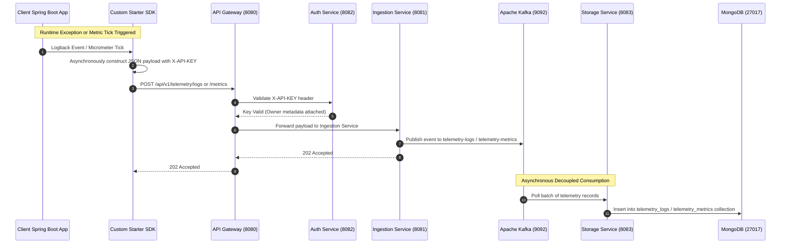
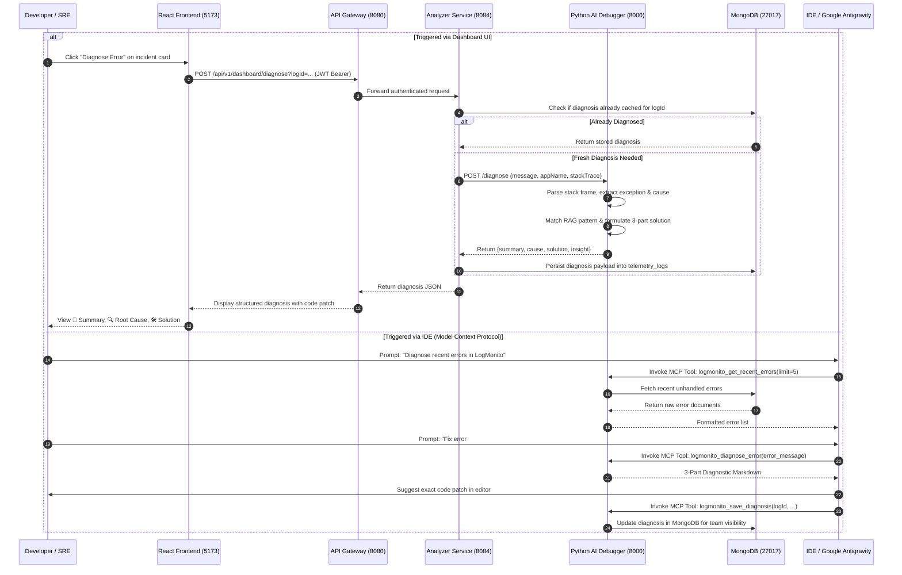
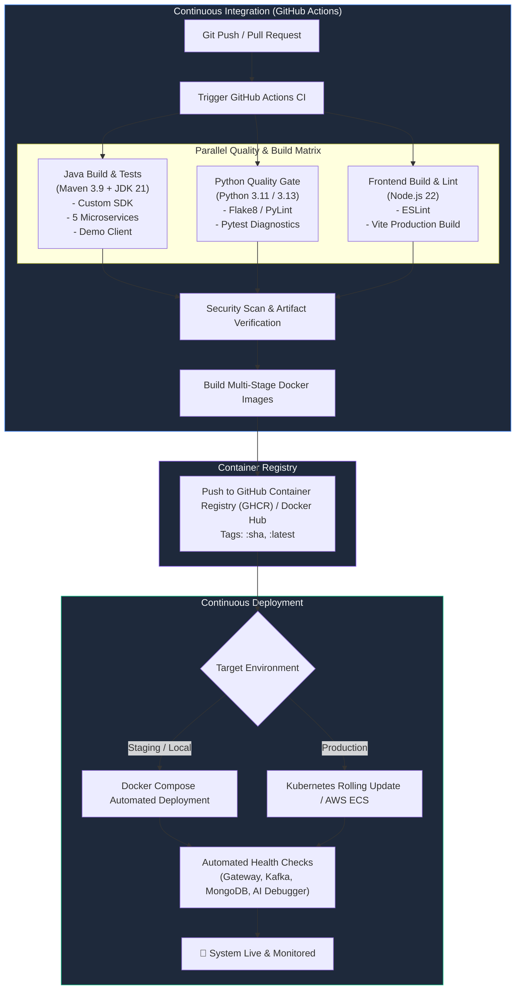

# ⚡ LogMonito

> **AI-Powered Distributed Telemetry Monitoring & Automated Root-Cause Diagnostics Platform for Spring Boot Microservices**

[](https://openjdk.org/)
[](https://spring.io/projects/spring-boot)
[](https://kafka.apache.org/)
[](https://www.mongodb.com/)
[](https://fastapi.tiangolo.com/)
[](https://react.dev/)
[](https://www.docker.com/)
[](https://modelcontextprotocol.io/)

---

## 📑 Table of Contents
1. [Overview](#-overview)
2. [Problem Statement](#-problem-statement)
3. [The LogMonito Solution](#-the-logmonito-solution)
4. [Key Features](#-key-features)
5. [System Architecture](#-system-architecture)
6. [Architectural Flowcharts](#-architectural-flowcharts)
   - [Telemetry Ingestion Pipeline](#1-telemetry-ingestion-pipeline)
   - [Automated AI Root-Cause Diagnostics Flow](#2-automated-ai-root-cause-diagnostics-flow)
   - [CI/CD & Deployment Pipeline](#3-cicd--deployment-pipeline)
7. [Technology Stack](#-technology-stack)
8. [Microservices & Component Breakdown](#-microservices--component-breakdown)
9. [Custom Spring Boot Starter SDK](#-custom-spring-boot-starter-sdk)
10. [AI Debugger & Model Context Protocol (MCP)](#-ai-debugger--model-context-protocol-mcp)
11. [CI/CD Pipeline Specification](#-cicd-pipeline-specification)
12. [Deployment Guide](#-deployment-guide)
   - [Prerequisites](#prerequisites)
   - [Local Orchestration (Docker Compose)](#local-orchestration-docker-compose)
   - [Production Cloud Deployment](#production-cloud-deployment)
13. [Testing & Error Simulation (Demo Client)](#-testing--error-simulation-demo-client)
14. [Repository Directory Structure](#-repository-directory-structure)
15. [License & Acknowledgments](#-license--acknowledgments)

---

## 🌟 Overview

**LogMonito** is an end-to-end, cloud-native telemetry monitoring and automated incident diagnosis platform engineered specifically for distributed **Java / Spring Boot** microservice ecosystems. 

Combining a custom zero-configuration Java SDK, high-throughput asynchronous message streaming via **Apache Kafka**, scalable document storage in **MongoDB**, and a specialized **FastAPI AI Diagnostic Bridge** equipped with the **Model Context Protocol (MCP)**, LogMonito bridges the gap between passive log aggregation and proactive, automated incident remediation.

---

## ❗ Problem Statement

Modern enterprise microservice architectures present severe operational challenges:

* **Cryptic Distributed Stack Traces**: A single failed transaction in a distributed chain produces multi-layered, deeply nested stack traces spread across multiple nodes. Deciphering root causes manually is time-consuming and error-prone.
* **Cascading Failures**: Database connection pool exhaustion (e.g., HikariCP timeouts), network socket drops, and Kafka message deserialization errors frequently propagate across services, causing full outages.
* **Elevated MTTD and MTTR**: On-call Site Reliability Engineers (SREs) and backend developers waste critical hours cross-referencing log files, querying databases, and searching StackOverflow or internal runbooks to determine why a service crashed.
* **Passive Monitoring vs. Actionable Remediation**: Conventional log aggregation tools (ELK, Splunk, CloudWatch) act as passive data sinks. They alert teams that an error occurred, but leave the cognitive burden of diagnosis and code remediation entirely to engineers.
* **SDK Overhead**: Standard application monitoring tools often introduce heavy dependencies, blocking I/O overhead, or complex multi-step instrumentation that slows down application throughput.

---

## 💡 The LogMonito Solution

LogMonito transforms passive logging into **instant, actionable intelligence**:

1. **Non-Blocking Plug-and-Play SDK (`monitor-spring-boot-starter`)**: Spring Boot applications simply include the starter dependency. It hooks into Logback to stream `WARN` and `ERROR` logs asynchronously via HTTP and periodically transmits CPU and JVM memory metrics using Micrometer gauges without hindering request threads.
2. **Decoupled, High-Throughput Streaming Backbone**: Ingestion requests hit an API Gateway, are validated via lightweight API keys, and are immediately buffered into **Apache Kafka** topics, ensuring zero data loss during high-traffic spikes.
3. **Asynchronous Persistence Layer**: A headless **Storage Service** consumes Kafka events in batches and persists indexed telemetry documents into **MongoDB**.
4. **Automated AI Root-Cause Diagnostics**: Whenever an unhandled exception or critical error is detected, LogMonito's AI Debugger analyzes the stack trace, extracts the faulting class and line, identifies the failure domain (HikariCP, MongoDB socket, DTO validation, NullPointer, Kafka deserialization, downstream HTTP timeouts), and synthesizes a structured 3-part diagnostic report:
   - 📌 **Error Summary**: What broke and which service was affected.
   - 🔍 **Root Cause**: The exact technical failure mechanism.
   - 🛠️ **Actionable Solution & Code Patch**: Step-by-step fix including configuration and code snippets.
5. **Model Context Protocol (MCP) Integration**: LogMonito exposes native MCP tools, allowing IDE AI agents (e.g., Google Antigravity, Cursor, Claude Code) to inspect live runtime errors directly from MongoDB, trigger diagnostics, and apply verified code patches directly within the developer's workspace.
6. **Real-Time Interactive Dashboard**: A sleek **React 18 + Tailwind CSS** UI with live metrics visualizations, incident triage lists, and one-click AI diagnosis triggers.

---

## 🚀 Key Features

* ⚡ **Zero-Code Instrumentation**: Add the starter dependency to `pom.xml`, configure your API key, and telemetry begins flowing instantly.
* 🛡️ **Edge Security**: Spring Cloud Gateway with dual-layer security—HMAC SHA-256 JWT validation for user access and `X-API-KEY` checks for telemetry ingestion.
* 📨 **Kafka-Buffered Ingestion**: Backpressure-resilient architecture preventing database write saturation during traffic bursts.
* 🧠 **Deterministic & RAG AI Analysis**: High-precision stack trace normalization backed by an enterprise Spring Boot troubleshooting knowledge base (`docs/rag/springboot_error_handbook_rag.md`).
* 🔌 **Native IDE MCP Integration**: Seamlessly connect your IDE AI assistant to runtime telemetry using standard Model Context Protocol JSON-RPC over `stdio`.
* 📊 **Telemetry Correlation**: Correlate system metrics (JVM memory, CPU usage) with runtime exceptions to distinguish memory leaks from software bugs.
* 🐳 **Container-Native**: Completely containerized multi-stage Docker builds orchestrated via Docker Compose.

---

## 🏗️ System Architecture

LogMonito employs an event-driven, microservices-based architecture designed for high scalability, fault isolation, and decoupled processing:

```
+--------------------------------------------------------------------------------------------------+
|                                    CLIENT ECOSYSTEM                                              |
|                                                                                                  |
|   +---------------------------------------+       +------------------------------------------+   |
|   |   Spring Boot Service A (Orders)     |       |   Spring Boot Service B (Payments)       |   |
|   |   +-------------------------------+   |       |   +----------------------------------+   |   |
|   |   |  monitor-spring-boot-starter  |   |       |   |   monitor-spring-boot-starter    |   |   |
|   |   |  - HttpLogAppender (Async)    |   |       |   |   - HttpLogAppender (Async)      |   |   |
|   |   |  - MetricsForwarder (Actuator)|   |       |   |   - MetricsForwarder (Actuator)  |   |   |
|   |   +---------------+---------------+   |       |   +----------------+-----------------+   |   |
|   +-------------------|-------------------+       +--------------------|---------------------+   |
+-----------------------|------------------------------------------------|-------------------------+
                        | HTTP Telemetry (/api/v1/telemetry/*)           |
                        +-----------------------+------------------------+
                                                |
                                                v
+--------------------------------------------------------------------------------------------------+
|                                  LOGMONITO CORE PLATFORM                                         |
|                                                                                                  |
|   +------------------------------------------------------------------------------------------+   |
|   |                   API Gateway (Spring Cloud Gateway - Port 8080)                         |   |
|   |                   - Route Predicates & Dynamic Proxying                                  |   |
|   |                   - ApiKeyFilter (X-API-KEY validation)                                  |   |
|   |                   - JwtAuthFilter (HMAC SHA-256 validation)                              |   |
|   +-----------+-----------------------------------+------------------------------------+-----+   |
|               |                                   |                                    |         |
|               v                                   v                                    v         |
|   +-----------------------+           +-----------------------+            +-----------------+   |
|   |   Ingestion Service   |           |     Auth Service      |            | Analyzer Service|   |
|   |   (Port 8081)         |           |     (Port 8082)       |            | (Port 8084)     |   |
|   |   - Rest Endpoints    |           |     - User Auth       |            | - Dashboard API |   |
|   |   - Kafka Producer    |           |     - API Key Gen     |            | - Metric Slices |   |
|   +-----------+-----------+           +-----------+-----------+            +--------+--------+   |
|               |                                   |                                 |            |
|               v                                   |                                 | HTTP       |
|   +-----------------------+                       |                                 v            |
|   |     Apache Kafka      |                       |                    +---------------------+   |
|   |     (Port 9092)       |                       |                    |  Python AI Debugger |   |
|   | - telemetry-logs      |                       |                    |  (Port 8000)        |   |
|   | - telemetry-metrics   |                       |                    |  - FastAPI Engine   |   |
|   +-----------+-----------+                       |                    |  - MCP Server       |   |
|               |                                   |                    +----------+----------+   |
|               v                                   |                               |              |
|   +-----------------------+                       |                               |              |
|   |    Storage Service    |                       |                               |              |
|   |    (Port 8083)        |                       |                               |              |
|   |  - Kafka Consumer     |                       |                               |              |
|   +-----------+-----------+                       |                               |              |
|               |                                   |                               |              |
|               v                                   v                               v              |
|   +------------------------------------------------------------------------------------------+   |
|   |                             MongoDB Database (Port 27017)                                |   |
|   |   - telemetry_logs (with diagnosis payload)      - telemetry_metrics                     |   |
|   |   - users                                        - api_keys                              |   |
|   +------------------------------------------------------------------------------------------+   |
+--------------------------------------------------------------------------------------------------+
                                                ^
                                                |
+-----------------------------------------------+--------------------------------------------------+
|                                  USER & IDE INTERFACES                                           |
|                                                                                                  |
|   +----------------------------------------------+   +---------------------------------------+   |
|   |        React 18 Frontend Dashboard           |   |       Google Antigravity / IDE        |   |
|   |        (Port 5173 - Vite + Tailwind)         |   |       (MCP JSON-RPC over stdio)       |   |
|   +----------------------------------------------+   +---------------------------------------+   |
+--------------------------------------------------------------------------------------------------+
```

---

## 🔄 Architectural Flowcharts

### 1. Telemetry Ingestion Pipeline



### 2. Automated AI Root-Cause Diagnostics Flow



### 3. CI/CD & Deployment Pipeline



---

## 🛠️ Technology Stack

| Layer | Technologies | Rationale / Key Capabilities |
| :--- | :--- | :--- |
| **Client Instrumentation** | Java 21, Spring Boot Starter, Logback Core, Micrometer | Non-blocking asynchronous logging appender; scheduled JVM metrics forwarder without external agent dependencies. |
| **API Gateway** | Spring Cloud Gateway, Reactive WebFlux, Netty | Non-blocking reverse proxy, route routing, CORS configuration, JWT authentication, and header-based API key validation. |
| **Core Microservices** | Spring Boot 3.5.x, Spring Web, Spring Data MongoDB, Spring Kafka, Lombok | Robust microservice foundation with enterprise Kafka integration and native MongoDB driver support. |
| **Message Streaming** | Apache Kafka 7.5 (Confluent), Apache Zookeeper | Distributed, fault-tolerant message streaming buffer ensuring high-throughput telemetry ingestion without backpressure. |
| **Persistence Layer** | MongoDB 7.0 Community Edition | High-performance document database supporting dynamic unstructured log payloads, nested metadata, and time-series telemetry. |
| **AI Diagnostics & MCP** | Python 3.11+, FastAPI, Uvicorn, Model Context Protocol (FastMCP/MCPServer), PyMongo | Microservice providing regex stack frame decomposition, automated incident diagnosis, and native IDE agent connectivity via MCP. |
| **Frontend Dashboard** | React 18, Vite, Tailwind CSS, Lucide React | High-performance single-page application with responsive UI, real-time error cards, and live system resource visualizations. |
| **DevOps & Containers** | Docker, Docker Compose, Eclipse Temurin 21 Alpine, Node 22 Alpine | Lightweight, multi-stage container images optimized for fast cold-starts and minimal security surface. |
| **CI/CD Automation** | GitHub Actions, Maven Wrapper, NPM, Pytest | Automated matrix builds, linting, unit testing, Docker image building, and container registry publishing. |

---

## 📦 Microservices & Component Breakdown

### 1. `ApiGatewayMonitor` (Port: `8080`)
* **Role**: The perimeter edge gateway for all external traffic.
* **Key Functions**:
  * Evaluates incoming requests and proxies traffic to internal services.
  * `ApiKeyFilter`: Authenticates client microservice ingestion requests via `X-API-KEY`.
  * `JwtAuthFilter`: Validates HMAC SHA-256 JWT tokens for frontend dashboard API routes.
  * Handles Global CORS policies for browser clients.

### 2. `IngestionService` (Port: `8081`)
* **Role**: Ultra-fast telemetry ingestion worker.
* **Key Functions**:
  * Exposes `/api/v1/telemetry/logs` and `/api/v1/telemetry/metrics`.
  * Directly transforms payloads into JSON and publishes them to dedicated Kafka topics (`telemetry-logs`, `telemetry-metrics`).
  * Operates statelessly for horizontal auto-scaling.

### 3. `StorageService` (Port: `8083`)
* **Role**: Asynchronous Kafka event consumer and persistence engine.
* **Key Functions**:
  * Headless Spring Boot worker configured with `storage-group`.
  * Deserializes Kafka messages using Spring Kafka trusted package mappings.
  * Performs batch upserts and writes documents directly to MongoDB.

### 4. `AuthServiceMon` (Port: `8082`)
* **Role**: Identity, credential, and API key management.
* **Key Functions**:
  * User registration and authentication returning signed JWT tokens.
  * Dynamic generation of project-specific API keys (`logmonito_live_...`).
  * Gateway validation endpoint verifying active API keys.

### 5. `AnalyzerService` (Port: `8084`)
* **Role**: Analytics and AI coordination hub.
* **Key Functions**:
  * Serves dashboard metric queries (last 10 errors, CPU/memory sliding windows).
  * Orchestrates AI diagnostics by querying the Python AI Debugger when a user inspects an incident.
  * Caches returned AI diagnosis payloads directly into MongoDB so investigations are instantly shared across team members.

### 6. `ai-debugger` (Port: `8000`)
* **Role**: Intelligent root-cause analysis engine and IDE tool provider.
* **Key Functions**:
  * **FastAPI Service (`api_service.py`)**: REST endpoint `/diagnose` providing sub-second automated stack trace decomposition and resolution generation.
  * **Model Context Protocol Server (`mcp_server.py`)**: Exposes native MCP tools (`logmonito_get_recent_errors`, `logmonito_diagnose_error`, `logmonito_get_metrics`, `logmonito_save_diagnosis`) for Google Antigravity and Claude Desktop.
  * **Knowledge Base (`docs/rag/springboot_error_handbook_rag.md`)**: Comprehensive production runbooks covering HikariCP pool starvation, MongoDB socket timeouts, validation constraints, and Kafka deserialization issues.

### 7. `frontend` (Port: `5173`)
* **Role**: Interactive web dashboard for SREs and developers.
* **Key Functions**:
  * Real-time telemetry monitoring with auto-refreshing error timelines.
  * One-click AI diagnosis modal displaying summary, root cause, and suggested code fix.
  * Project API key generation and management interface.

### 8. `Custom SDK (monitor-spring-boot-starter)`
* **Role**: Lightweight zero-dependency client starter library.
* **Key Functions**:
  * Automatically registers `HttpLogAppender` to capture `WARN` and `ERROR` logs.
  * Schedules non-blocking `MetricsForwarder` pushing CPU and memory metrics to the gateway.

### 9. `demo-client` (Port: `8085`)
* **Role**: Standalone testing microservice.
* **Key Functions**:
  * Pre-configured with the custom SDK starter.
  * Provides test endpoints (`/null-pointer`, `/database-failure`, `/arithmetic`, `/checkout`, `/payment-timeout`) to simulate real production failures.

---

## 💻 Custom Spring Boot Starter SDK

Integrating any Spring Boot microservice into LogMonito requires **three simple steps**:

### Step 1: Add Dependency to `pom.xml`

```xml
<dependency>
    <groupId>com.example</groupId>
    <artifactId>monitor-spring-boot-starter</artifactId>
    <version>0.0.1-SNAPSHOT</version>
</dependency>
```

### Step 2: Configure `application.yml`

```yaml
monitor:
  server-url: "http://localhost:8080"           # LogMonito API Gateway address
  api-key: "YOUR_PROJECT_API_KEY_HERE"          # Generated in LogMonito Dashboard
  app-name: "order-service"                     # Identifier for your microservice
  log-level: "WARN"                             # Threshold: WARN or ERROR (defaults to WARN)
  metrics-interval: 60000                       # Metrics push interval in milliseconds (default: 60s)
```

### Step 3: Run Your Application
The starter's `MonitorAutoConfiguration` automatically detects the properties, wires the `HttpLogAppender` into your Logback context, and launches the scheduled `MetricsForwarder` in background worker threads. **Zero boilerplate code required.**

---

## 🤖 AI Debugger & Model Context Protocol (MCP)

LogMonito features first-class support for the **Model Context Protocol (MCP)**, allowing AI developer assistants (such as Google Antigravity, Cursor, and Claude Code) to interact with live production telemetry right from the IDE.

### MCP Tools Provided

| Tool Name | Parameters | Description |
| :--- | :--- | :--- |
| `logmonito_get_recent_errors` | `limit: int = 5`, `app_name: str = ""` | Queries MongoDB for the most recent unhandled runtime exceptions across microservices. |
| `logmonito_diagnose_error` | `error_message: str`, `app_name: str = ""` | Runs the AI diagnostic engine on a stack trace to generate Summary, Root Cause, and Solution. |
| `logmonito_get_metrics` | `app_name: str = ""`, `limit: int = 5` | Fetches CPU and memory telemetry ticks to correlate resource spikes with crashes. |
| `logmonito_save_diagnosis` | `log_id: str`, `summary`, `cause`, `solution` | Writes an AI-generated diagnosis directly into MongoDB so it displays on the web dashboard. |

### Connecting to Google Antigravity / Claude Desktop

Add the following block to your MCP configuration file (`mcp_config.json`):

```json
{
  "mcpServers": {
    "logmonito": {
      "command": "python",
      "args": [
        "c:/Users/sujal/IdeaProjects/LogMonito/ai-debugger/mcp_server.py"
      ],
      "env": {
        "MONGODB_URI": "mongodb://localhost:27017/ai_monitoring_db"
      }
    }
  }
}
```

Now, you can prompt your AI assistant:
> *"Check LogMonito for recent errors in order-service and diagnose the latest database failure."*

---

## ⚙️ CI/CD Pipeline Specification

LogMonito includes an automated, production-grade **GitHub Actions** CI/CD pipeline definition (`.github/workflows/ci-cd.yml`) that guarantees code quality, runs multi-module unit tests, packages Docker images, and deploys updates.

### Pipeline Stages

1. **Linting & Code Formatting**:
   - Java: Spotless / Checkstyle validation.
   - Python: `flake8` and `pylint` static analysis on `ai-debugger`.
   - Frontend: ESLint validation.
2. **Automated Testing Matrix**:
   - `mvn test` executed across all Maven modules (SDK, Ingestion, Storage, Auth, Analyzer, Demo Client).
   - `pytest` executed against the AI Debugger stack trace heuristics.
3. **Multi-Stage Container Packaging**:
   - Builds minimal, secure container images using multi-stage Dockerfiles (`eclipse-temurin:21-jre-alpine` for Java and `node:22-alpine` for React).
4. **Container Registry Push**:
   - Authenticates and publishes tagged container images to GitHub Container Registry (`ghcr.io`) or Docker Hub.
5. **Continuous Deployment (CD)**:
   - Automated webhook / SSH trigger deploying updated containers via Docker Compose or Kubernetes rolling updates.

---

## 🚀 Deployment Guide

### Prerequisites
* **Docker Engine** (24.0+) & **Docker Compose** (v2.20+)
* **Java Development Kit (JDK) 21** (for local development)
* **Maven 3.9+**
* **Python 3.11+**
* **Node.js 20+** & **npm 10+**

---

### Local Orchestration (Docker Compose)

The entire LogMonito platform (Zookeeper, Kafka, Auth, Ingestion, Storage, Analyzer, Gateway, and Dashboard) can be launched with a single command:

```bash
# 1. Clone the repository
git clone https://github.com/SujalSawant-97/LogMonito.git
cd LogMonito

# 2. Build and launch all containerized microservices
docker-compose up --build -d

# 3. Verify all containers are healthy
docker-compose ps
```

#### Launching the Python AI Debugger Service (Host or Container)

```bash
cd ai-debugger

# Create and activate virtual environment
python -m venv .venv
.\.venv\Scripts\activate   # On Windows
# source .venv/bin/activate  # On Linux/macOS

# Install dependencies
pip install -r requirements.txt

# Start the FastAPI AI diagnostic server (port 8000)
python api_service.py
```

#### Launching the Frontend Dashboard (Development Mode)

```bash
cd frontend
npm install
npm run dev
```

The React dashboard is accessible at: **`http://localhost:5173`**

---

### Port Allocation Reference

| Port | Service | Protocol | Description |
| :--- | :--- | :--- | :--- |
| **8080** | `api-gateway` | HTTP | Perimeter Gateway (Routes, CORS, JWT & API Key Security) |
| **8081** | `ingestion-service` | HTTP | Internal Telemetry Ingestion Receiver |
| **8082** | `auth-service` | HTTP | Authentication & Project API Key Management |
| **8083** | `storage-service` | Internal | Kafka Consumer & MongoDB Persister (Headless) |
| **8084** | `analyzer-service` | HTTP | Dashboard Analytics API & AI Diagnostic Broker |
| **8000** | `ai-debugger` | HTTP/MCP | FastAPI AI Diagnostic Service & FastMCP Server |
| **5173** | `frontend` | HTTP | Vite React Web Dashboard |
| **9092** | `kafka` | TCP | Apache Kafka Message Broker |
| **2181** | `zookeeper` | TCP | Apache Zookeeper Coordinator |
| **27017**| `mongodb` | TCP | Telemetry Document Store |
| **8085** | `demo-client` | HTTP | Sample Client Application for Error Generation |

---

### Production Cloud Deployment

For enterprise production deployments on **AWS (ECS / EKS)**, **Google Cloud (GKE)**, or **DigitalOcean Kubernetes**:

1. **Managed Streaming**: Replace the self-hosted Kafka container with **AWS MSK** or **Confluent Cloud**.
2. **Managed Database**: Connect `SPRING_DATA_MONGODB_URI` to **MongoDB Atlas** with Replica Set configuration and TLS enabled.
3. **Container Ingress**: Deploy the `api-gateway` behind an AWS Application Load Balancer (ALB) or Nginx Ingress Controller with TLS certificate termination.
4. **Configuration Secrets**: Inject JWT secrets, MongoDB credentials, and Kafka connection strings using **HashiCorp Vault**, **AWS Secrets Manager**, or **Kubernetes Secrets**.

---

## 🧪 Testing & Error Simulation (Demo Client)

LogMonito includes a standalone client microservice (`demo-client`) to simulate real-world production errors and verify the entire ingestion-to-diagnosis pipeline:

```bash
# Start the demo client (runs on port 8085)
cd demo-client
mvn spring-boot:run
```

Trigger simulated failure scenarios:

```bash
# 1. Null Pointer Exception (Unhandled Runtime Crash)
curl http://localhost:8085/api/test/null-pointer

# 2. Arithmetic Exception (Divide by Zero)
curl http://localhost:8085/api/test/arithmetic

# 3. Database Connectivity Failure (MongoSocketOpenException Simulation)
curl http://localhost:8085/api/test/database-failure

# 4. DTO Validation Constraint Failure
curl -X POST http://localhost:8085/api/test/checkout \
     -H "Content-Type: application/json" \
     -d '{"item": "Laptop"}'

# 5. Caught Exception with Explicit log.error(...)
curl http://localhost:8085/api/test/payment-timeout
```

Navigate to the **LogMonito Dashboard** (`http://localhost:5173`) to view the incidents streaming in real time and click **"Diagnose"** to trigger immediate AI root-cause analysis!

---

## 📂 Repository Directory Structure

```text
LogMonito/
├── .github/                                # CI/CD automation workflows
│   └── workflows/
│       └── ci-cd.yml                       # Build, test, containerize, and deploy pipeline
├── ai-debugger/                            # Python AI Diagnostic Microservice & MCP Server
│   ├── api_service.py                      # FastAPI REST server exposing /diagnose endpoint
│   ├── diagnostics.py                      # Heuristic & RAG stack trace diagnostic engine
│   ├── mcp_server.py                       # Model Context Protocol (MCP) server for IDEs
│   ├── check_mongo.py                      # MongoDB connectivity diagnostic helper
│   ├── requirements.txt                    # Python runtime dependencies
│   └── run_api.bat                         # Windows quick-launch script
├── Backend Application/                    # Spring Boot Distributed Microservices
│   ├── AnalyzerService/                    # Dashboard aggregation & AI broker (Port 8084)
│   ├── ApiGatewayMonitor/                  # Spring Cloud Gateway edge router (Port 8080)
│   ├── AuthServiceMon/                     # User authentication & API key generator (Port 8082)
│   ├── IngestionService/                   # High-throughput Kafka telemetry producer (Port 8081)
│   └── StorageService/                     # Kafka consumer worker & MongoDB persister (Port 8083)
├── Custom SDK/                             # Client Instrumentation SDK
│   └── monitor-spring-boot-starter/        # Zero-code starter for client Spring Boot applications
│       ├── src/main/java/com/example/...
│       │   ├── monitor/HttpLogAppender.java     # Non-blocking async Logback appender
│       │   ├── monitor/MetricsForwarder.java    # Scheduled Actuator CPU/Memory forwarder
│       │   └── monitor/MonitorAutoConfiguration.java # Auto-configuration hook
│       └── pom.xml
├── demo-client/                            # Standalone test application with simulated errors
│   ├── src/main/java/com/example/democlient/
│   │   ├── controller/TestController.java  # Error injection endpoints (NPE, DB, Kafka, etc.)
│   │   └── DemoClientApplication.java
│   └── pom.xml
├── docs/                                   # Architectural Documentation & Knowledge Base
│   ├── rag/
│   │   ├── springboot_error_handbook_rag.md # Enterprise error troubleshooting runbooks
│   │   └── SpringBoot_Error_Resolution_Knowledge_Base.html
│   └── SpringBoot_Error_Resolution_Knowledge_Base.pdf
├── frontend/                               # React 18 Single-Page Application Dashboard
│   ├── src/                                # React components, pages, contexts, and API clients
│   ├── Dockerfile                          # Multi-stage production container build
│   ├── package.json                        # Frontend dependencies (Tailwind, Lucide, Vite)
│   └── vite.config.js
├── docker-compose.yml                      # Full-stack multi-container orchestration definition
├── .gitignore                              # Git exclusion rules
└── README.md                               # Project documentation & architecture manual
```

---

## 📜 License & Acknowledgments

This project is licensed under the **MIT License**.

Developed with ❤️ for developers and SREs seeking an intelligent, automated approach to modern microservice observability. Special thanks to the **Spring**, **Apache Kafka**, **FastAPI**, and **Model Context Protocol** open-source communities.
